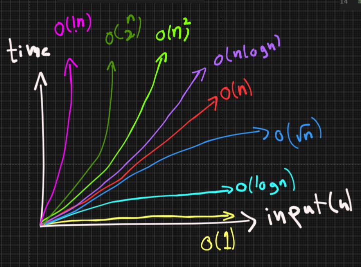

# Software Engineering Revisited

An interactive study site for **data structures and algorithms**, written in
Python and built with React. Every topic is explained from first principles
for a beginner, with real code, small animated diagrams, a cost table, and a
quiz you can test yourself on.

I'm building it to learn the material properly, by explaining each idea well
enough that someone with no background could follow it. If you're reviewing
this repo, the quickest way to judge the work is to open one finished page
(for example **Hash Tables** or **Linked Lists**) and read it top to bottom.

## What's inside

The curriculum follows the [roadmap.sh Data Structures & Algorithms
roadmap](https://roadmap.sh/datastructures-and-algorithms): **41 topics across
9 sections**, all in Python. Every topic has a fully written page.

| # | Section | Topics | Status |
|---|---------|--------|--------|
| 1 | Basic Data Structures | Arrays, Linked Lists, Queues, Stacks, Hash Tables | **Written** (all 5) |
| 2 | Algorithmic Complexity | Time vs Space, Calculating Complexity, Big-O, Common Runtimes | all four written |
| 3 | Sorting Algorithms | Bubble, Insertion, Selection, Merge, Quick, Heap | All six written |
| 4 | Search Algorithms | Linear, Binary | All two written |
| 5 | Tree Data Structures | Tree search, Traversals, Binary Trees, BST, AVL, B-Trees, Heaps | **Written** (all 7) |
| 6 | Graph Data Structures | Graph Theory Basics, Directed, Undirected, BFS/DFS, Dijkstra, Bellman-Ford, A*, Prim's, Kruskal's | **Written** (all 9) |
| 7 | Advanced Data Structures | Trie, Segment Tree, Fenwick Tree, Union-Find, Suffix Trees and Arrays | **Written** (all 5) |
| 8 | Indexing | Linear, Tree-based | **Written** (both) |
| 9 | Problem Solving | Techniques overview (recursion, greedy, backtracking, DP, two pointers, and more) | **Written** (all 16 techniques) |

Progress is tracked release by release in [CHANGELOG.md](CHANGELOG.md). The
current release is **1.0**, the first major version: the curriculum is complete,
with a written page for every one of the 41 topics. The last section added was
Problem Solving (16 techniques, each with a small isometric picture you step
through, and a short piece of Python), after the two Indexing pages from 0.8,
the five Advanced Data Structures pages from 0.7, the nine Graph Data Structures
pages from 0.6, the seven Tree Data Structures pages from 0.5, the two Search
Algorithms pages from 0.4, the six Sorting Algorithms pages from 0.3, the
Algorithmic Complexity pages from 0.2 and the five Basic Data Structures pages
from 0.1. Longer notes on the major releases are in `docs/releases/`.

## What a finished page looks like

Every rebuilt page follows the same structure, so you always know where to
look:

1. **One-page recap**: a two-column "paper" summary of the whole page, so you
   can skim it for a quick refresher.
2. **What it is**, in one sentence.
3. **The problem it solves**: why the structure exists and what goes wrong
   without it.
4. **The core idea**: the one insight that makes it work, usually with an
   analogy.
5. **How it works**: a small concrete example walked through step by step,
   with a diagram and runnable Python.
6. **What each operation costs**: a table of time and extra-space complexity,
   including the worst case and what causes it.
7. **Trade-offs**: how it compares with its nearest alternatives.
8. **When to use it**: real situations where you'd pick it.
9. **Test yourself**: a quiz where you guess the time and space complexity
   before the answer is revealed.

The Problem Solving page is the one exception: it is a list of techniques, each
with what it is, how it works and where it is usually used, plus a small picture
and a short piece of code.

Pages are written to be read by a beginner: new terms are explained where
they first appear, and later pages build on earlier ones (for example,
Hash Tables leans on what Arrays taught about mutability).



## Tech stack

- **React 19** and **Vite** for the app and dev server
- Plain **CSS** (no UI framework), with hand-built **SVG** diagrams
- **oxlint** for linting
- No backend and no database: it's a static site

## Run it locally

```bash
npm install
npm run dev
```

Then open the address Vite prints (usually http://localhost:5173).

Other commands:

```bash
npm run build     # production build into dist/
npm run preview   # serve the production build locally
npm run lint      # run oxlint
npm test           # run the unit tests (Node's built-in test runner)
```

## Project layout

```
src/
  topics.js                  The curriculum: every section and topic, with its summary
  App.jsx                    Layout and navigation state (section + topic)
  components/
    Sidebar.jsx              Left sidebar: the 9 sections
    SubtopicSidebar.jsx      Second sidebar: the topics in the chosen section
    ComplexityQuiz.jsx       The "guess the complexity" quiz used on every page
    CodeTracer.jsx           Play/step through code with the data animating alongside
    IsoRow.jsx               Isometric 3D cubes, used for the search animations
    TreeView.jsx             A tree drawn as coloured nodes, used by the tree pages
    BTreeView.jsx            A B-tree drawn as boxes holding several keys
    GraphView.jsx            A graph drawn with arrows, plus its list and matrix forms
    FenwickView.jsx          Fenwick tree bars over an array, plus numbers in binary
    SuffixRows.jsx           The sorted suffixes of a word as rows that slide into place
    IndexTables.jsx          A table with an index beside it, for the Indexing pages
  pages/
    index.js                 Maps a topic id to its page component
    Placeholder.jsx          Shown for topics that aren't written yet
    dataStructures/          One page per topic (e.g. HashTables.jsx), plus a
                             matching *Visuals.jsx file holding its diagrams
  styles/
    notebook.css             Shared look: code blocks, callouts, tables, paper recap
    visualAnimations.css     Shared animations for the diagrams
docs/releases/               Longer release notes for major releases
CHANGELOG.md                 What changed in each release
```

## Adding a topic

1. Add its entry to `src/topics.js` (a short summary is enough to start).
   It shows up automatically in the sidebar with a placeholder page. Optional
   `badges` (for example `badges: ['Educational']`) add small tags next to its name.
2. When it's ready to write, create the page in
   `src/pages/dataStructures/`, with a `Visuals` file for its diagrams.
3. Register the page in `src/pages/index.js` against the topic's id.

## Roadmap

With 1.0 the curriculum is complete. Next up is a rebuild of the Big-O page to
match the structure above, as the pages written since it have.
